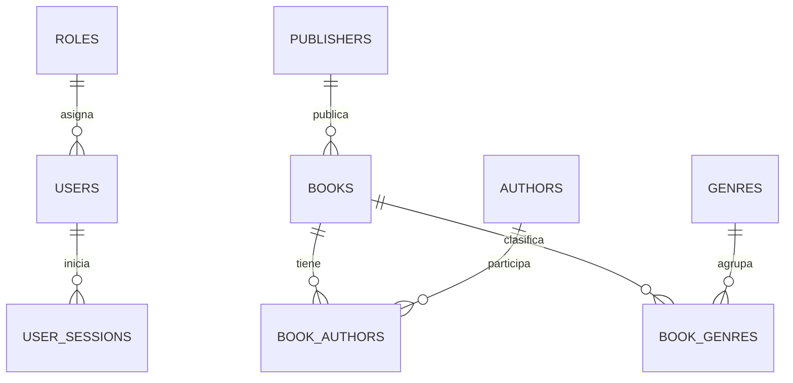

# Base de datos de La Biblioteca de Alejandría

## Contenido

- `001_initial_schema.sql`: extensiones, autenticación, sesiones y catálogo bibliográfico.
- `002_seed_data.sql`: roles, dos usuarios locales y cinco libros de demostración.

## Requisitos

- PostgreSQL 15 o superior.
- Extensiones `citext`, `pgcrypto` y `vector`/pgvector.

Supabase incluye estas extensiones. En una instalación local debe utilizarse una imagen de PostgreSQL que incluya pgvector.

## Aplicación

Ejecutar en orden:

```bash
psql "$DATABASE_URL" -v ON_ERROR_STOP=1 -f database/001_initial_schema.sql
psql "$DATABASE_URL" -v ON_ERROR_STOP=1 -f database/002_seed_data.sql
```

Ambos archivos usan transacciones. Si una sentencia falla, no se debe conservar una instalación parcial.

## Usuarios de demostración

| Rol | Correo | Contraseña inicial |
|---|---|---|
| Administrador | `admin@alejandria.local` | `Cambiar123!` |
| Usuario | `lector@alejandria.local` | `Cambiar123!` |

Estas credenciales son únicamente para desarrollo y demostración. Deben cambiarse o deshabilitarse antes de una publicación real.

El script semilla genera hashes bcrypt mediante `pgcrypto`. La API aceptará bcrypt para estas cuentas semilla y utilizará Argon2 para contraseñas creadas o modificadas desde la aplicación.

## Decisiones de diseño

- Los identificadores principales son UUID para evitar depender de secuencias entre ambientes.
- Los correos utilizan `CITEXT`, por lo que no distinguen mayúsculas de minúsculas.
- Una sesión almacena solamente el SHA-256 del refresh token.
- Los access tokens JWT no se almacenan en la base.
- Un libro admite varios autores, colaboradores y géneros.
- Los registros principales usan borrado lógico mediante `is_active`.
- `book_catalog` entrega una representación lista para la API.
- `books.search_vector` permite búsqueda textual local sin otro motor de búsqueda.
- La extensión pgvector queda habilitada para la siguiente migración del RAG.

## Relaciones principales



## Migraciones posteriores

Alembic administra los cambios posteriores al esquema inicial. La migración `0001_ai_history` agrega servicios de IA, conversaciones, mensajes y ejecuciones con consumo de tokens. La migración `0002_rag_documents` agrega documentos, fragmentos, vectores de 1536 dimensiones e índice HNSW por distancia coseno.

El contenedor backend ejecuta automáticamente `alembic upgrade head` antes de iniciar la API. También puede aplicarse manualmente:

```bash
cd backend
uv run alembic upgrade head
```

La dimensión del modelo de embeddings debe coincidir con `vector(1536)`. Cambiarla requiere una migración explícita de la columna y reconstruir los embeddings.
